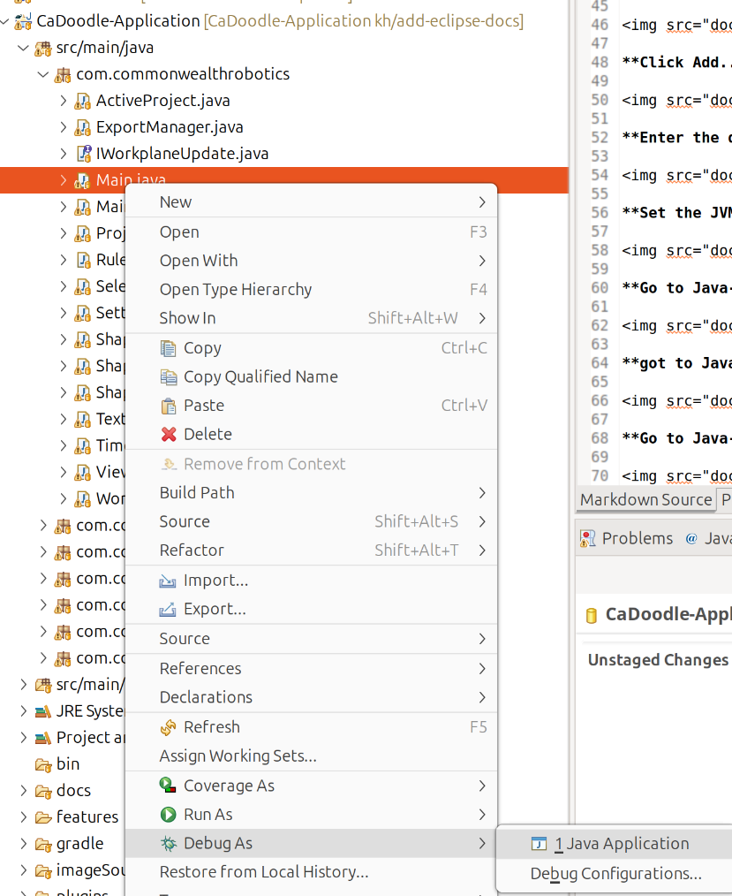

# Cadoodle Website


[https://cadoodlecad.com/](https://cadoodlecad.com/)


# CaDoodle-Application


[]()

The core Java Application for CaDoodle

This is the source code for the Java Application of Cadoodle. 

# Installers

The installers for specific operating systems can be found here: https://github.com/CommonWealthRobotics/CaDoodle/releases

## Windows Deployment

see the windows instructions https://github.com/CommonWealthRobotics/CaDoodle#windows-install

# Contribution Guide

[Check out the Contribution Guide](ContributionGuide.md)

# Checkout

```
git clone https://github.com/CommonWealthRobotics/CaDoodle-Application.git

cd CaDoodle-Application

git submodule update --init --recursive

cd BowlerStudio/

git checkout development 

cd libraries/bowler-script-kernel/

git checkout development 

cd GithubPasswordManager/

git checkout master 

cd ../

cd java-bowler/

git checkout development 

cd ..

cd JCSG/

git checkout development 

cd ../../../../

```

# Git Update

```

git pull

cd BowlerStudio/

git checkout development && git pull

cd libraries/bowler-script-kernel/

git checkout development && git pull

cd GithubPasswordManager/

git checkout master && git pull

cd ../

cd java-bowler/

git checkout development && git pull

cd ..

cd JCSG/

git checkout development && git pull

cd ../../../../

```

# Build (Linux)

```
bash build.sh
```

# Build (macOS)

```
brew install --cask blender freecad meshlab
brew install --cask openscad@snapshot

bash buildMac.sh
```


# Build (Windows)

1. Create the CadDoodle project directory (use a path without spaces), e.a. ```D:\CaDoodle```

2. Install MSYS2 from https://www.msys2.org to get a Linux bash shell.

3. Start the MSYS2 UCRT64 shell, all remaining commands will be executed in this shell.

4. Navigate to the CaDoodle project directory, e.a. ```cd /d/CaDoodle/```

5. Install the required updates, packages and clone the application (UCRT64 bash shell):
```
pacman -Syu --noconfirm

pacman -S git unzip --noconfirm

git clone https://github.com/CommonWealthRobotics/CaDoodle-Application.git

cd CaDoodle-Application

git submodule update --init --recursive
```

6. Download and extract the Java JDK. The JDK version comes from the single source of truth, jvm.json, via the getJdk scripts:
```
JVM_SCRIPTS=BowlerStudio/libraries/bowler-script-kernel/JCSG/jvm
JDK_NAME=$(bash $JVM_SCRIPTS/getJdkArchiveName.sh)
mkdir -p /d/CaDoodle/java
curl -L $(bash $JVM_SCRIPTS/getJdkUrl.sh) -o $JDK_NAME.zip
unzip -q $JDK_NAME.zip -d /d/CaDoodle/java
export JAVA_HOME=/d/CaDoodle/java/$JDK_NAME
```

Verify the path with ```ls $JAVA_HOME```

Optionally: Make JAVA_HOME persistent for the MSYS2 shell
```
echo 'export JAVA_HOME='$JAVA_HOME >> ~/.bash_profile
```

7. Build the application (UCRT64 bash shell):
```
./gradlew clean shadowJar
```

The build CaDoodle-Application.jar file will be located in ```build/libs```

The Windows CaDoodle application is located in the Windows user directory: ```users\<username>\bin\CaDoodle-ApplicationInstall```

# Eclipse instructions (Recommended)

[Eclipse setup Instructions Here](Eclipse.md)

**Right click on this file and Debug as Java Application**



# IntelliJ IDEA instructions

[IDEA setup Instructions Here](IntelliJ%20IDEA.md)


# Icons 

https://www.svgrepo.com/collection/solar-bold-icons/

# Themes

https://github.com/CommonWealthRobotics/Style-Cadoodle
